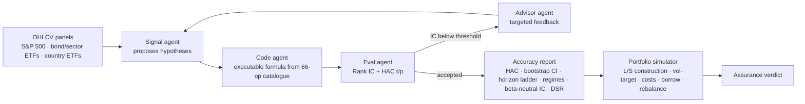

# Quantitative Signal Discovery Agent — Enhanced Fork

[](LICENSE.txt) [](pyproject.toml) [](tests/) [](https://github.com/NVIDIA-AI-Blueprints/quantitative-signal-discovery-agent)

**An AI/ML engineering take on NVIDIA's reference example: an autonomous, closed-loop LLM pipeline that discovers, codes, and backtests quantitative alpha hypotheses — rebuilt with the statistical and economic honesty gates that decide whether any of it is tradable.**

> Apache-2.0 fork of [NVIDIA's Quantitative Signal Discovery Agent](https://github.com/NVIDIA-AI-Blueprints/quantitative-signal-discovery-agent) — additive changes only; every new capability is opt-in and upstream defaults are unchanged.

**Author:** Shegs8422 · **Base:** NVIDIA-AI-Blueprints · **Stack:** NVIDIA NeMo Agent Toolkit · NVIDIA Nemotron 3.5 Lightning (hosted NIM) · Python 3.11–3.13 · pandas/scipy · yfinance · Arize Phoenix

This is **research-engineering software**: it finds statistically real structure cheaply and will also tell you, with receipts, when that structure dies on contact with costs, beta, regime dependence and portfolio construction. It is not investment advice, and nothing here is deployable capital machinery.

## Three-minute architecture read



Three cooperating agents close the loop (generate → code → evaluate → refine); the **fork's assurance layer** sits on the exit gate: an accepted signal must then survive cost-aware portfolio economics, regime inspection, and multiple-testing correction — or be shown, honestly, to fail it.

## 60-second offline demo (no API key, no network)

```bash
scripts/run_offline_demo.ps1    # Windows  (or ./scripts/run_offline_demo.sh)
# installs, runs 115 tests, then the accuracy report and portfolio simulation
# on a committed synthetic example (examples/demo_signal.json)
```

Same demo in [Docker](Dockerfile): `docker build -t qsda . && docker run --rm qsda`

## At a glance

| | |
|---|---|
| What it does | Loops Signal-agent → Code-agent → Eval-agent to ideate, implement and backtest cross-sectional alpha hypotheses over equity/ETF panels |
| Why this fork | Upstream accepts on \|IC\| ≥ 0.02 with independence-assuming t-stats. This fork adds HAC inference, cost-aware evaluation, portfolio construction, FX attribution and a multiple-testing registry — and reports the uncomfortable verdicts |
| Validation | 10 full workflow runs across S&P 500, bond ETFs, global bond ETFs, country ETFs; **3 acceptances, 0 investable after honest friction modeling** (see below) |
| Integrity | Additive-only fork (upstream untouched); 115/115 pytest; ruff-clean; opt-in-only changes |

## What this fork adds (all opt-in)

- **Tier-1 data universes** — `nasdaq100`, `dow30`, `country_etfs`, `sector_etfs`, `bond_etfs`, `global_bond_etfs`, `factor_etfs` presets (+ custom `--tickers`), `$SIGNAL_DATA_DIR` switching, FX pair downloads
- **HAC-aware acceptance** (`configs/config-optimization-hac.yml`) — Newey–West t/p gate before "accepted" suffers no more lucky candidates (it rejected a naive-p = 0.031 / HAC p = 0.203 iteration the upstream rule would have rubber-stamped)
- **Accuracy report** (`signal_report.py`) — daily IC series, HAC t/p, block-bootstrap CI, horizon ladder (1/5/10/21/63d), signal autocorrelation, regime splits, market-beta-neutral residualized IC, Bonferroni trial registry, **Deflated Sharpe Ratio**
- **Portfolio simulator** (`portfolio_sim.py`) — dollar-neutral long/short construction, causal vol targeting, one-way costs, borrow model, daily/weekly/monthly rebalance
- **Robustness frontier** (`robustness.py`) — direction × cost × rebalance grid for any saved signal (frontier over single best cell)
- **FX attribution** — re-executes saved signal code in local currency for country panels (`--local-currency`)
- **Observability fix** — `nvidia-nat[profiler]` restores LLM-level spans + token counts in Phoenix (upstream captured CHAIN roots only)
- **Operator-hallucination aliases** — near-miss model outputs mapped to the vetted operator catalogue

## Honest results (2026-11-12 validation campaign)

| Run | Universe | Status | \|IC\| | HAC p | Post-friction autopsy |
|---|---|---|---|---|---|
| momentum | bond_etfs | **accepted** ✅ | 0.0322 | — | −33%/yr daily, −5%/yr monthly; L/S spread ≈ 0 after 10 bps/26% turnover |
| momentum (HAC gate) | bond_etfs | **accepted** ✅ | 0.0350 | 0.0025 | beta, not selection alpha (residualized IC ≈ 0) |
| momentum (HAC gate) | global_bond_etfs | **accepted** ✅ | 0.0229 | 0.042 | bootstrap CI barely clears 0; portfolio −2.3%/yr |
| momentum | sp500 | best_effort | 0.0119 | — | inverse-predictive |
| mean reversion | sp500 | best_effort | 0.0167 | — | t = −6.3; nearest miss |

**Every accepted signal fails the investability bar once costs, beta and regimes are priced in.** That is the finding: LLM agents find significant structure reliably; whether it is *deployable* is a separate, harder question this fork is built to answer. See `docs/EXPERIMENTS.md` and `docs/INVESTMENT_ASSURANCE.md` for the full autopsy and the governance checklist required before any capital consideration.

## Quickstart

```bash
uv sync --locked
.venv\Scripts\python.exe -m pip install "nvidia-nat[profiler]"   # LLM-level Phoenix spans
uv run python -m signal_discovery_workflow.download_data --universe bond_etfs
uv run phoenix serve                                            # http://localhost:6006
# hosted NIM: nvidia/nemotron-3.5-lightning-30b-a3b — live, no local GPU required
uv run nat run --config_file configs/config-optimization-hac.yml --input "momentum signals"
uv run python -m signal_discovery_workflow.signal_report src/signal_discovery_workflow/output/signal_xxx.json --data-dir src/signal_discovery_workflow/data/bond_etfs
```

> Standard build.nvidia.com keys can only call a subset of the 84-model catalog. The full entitlement map (13 working models, everything else 404s) measured on 2026-11-12 is in `docs/BENCHMARK.md` — the three usable reasoning models for this workflow are `nemotron-3.5-lightning-30b-a3b`, `nemotron-3.5-bolt-e4b`, and `nemotron-3-nano-omni-30b-a3b-reasoning`.

Full upstream walkthrough (notebooks, CLI, Brev deployment) follows below under the original NVIDIA documentation.

## Credits & acknowledgements

This work stands entirely on NVIDIA's reference example. Credit where it is due — none of this works without their architecture:

- **NVIDIA AI Blueprints** — [quantitative-signal-discovery-agent](https://github.com/NVIDIA-AI-Blueprints/quantitative-signal-discovery-agent) blueprint (Apache-2.0): the closed-loop Signal → Code → Evaluation architecture, operator catalogue, prompt strategy, data pipeline and backtesting engine
- **NVIDIA NeMo Agent Toolkit** — multi-agent orchestration and observability framework
- **NVIDIA Nemotron 3.5 Lightning** — open reasoning model (hosted NIM) powering all three agents via build.nvidia.com
- **NVIDIA NIM** — hosted inference for the agent LLMs
- **Arize Phoenix** — LLM tracing and run observability
- **yfinance** — market data; **pandas / NumPy / SciPy** — analytics
- Apache-2.0 license retained; NVIDIA copyright headers preserved in all modified files; modifications are additive and documented in [Local Fork Modifications](#local-fork-modifications). NVIDIA is a trademark of NVIDIA Corporation.

## Honest limitations

Current-constituent universes (survivorship bias), no delisted returns, no market-impact model, unhedged FX on international panels, overlapping horizons (annualized figures inflated), small panels (bond_etfs k=2 buckets), no slippage/borrow desk integration, and a 10-run multiple-testing regime that Bonferroni can only partially correct. Nothing here replaces independent model validation, out-of-sample holdout, paper trading, or a risk committee. More in `docs/INVESTMENT_ASSURANCE.md`.

---

# Upstream example — NVIDIA's Quantitative Signal Discovery Agent (original docs)


An end-to-end signal discovery workflow for quantitative finance using NVIDIA NeMo Agent Toolkit. This workflow demonstrates how to leverage LLMs to automatically generate, code, and evaluate alpha signals.

## Overview

Signal discovery is the process of finding quantitative signals — also known as alpha signals — that have predictive power for future stock returns. This workflow automates the traditional labor-intensive process using LLMs.

### Workflow Architecture


The workflow uses a **closed-loop optimization** approach:
1. Generate signal ideas using an LLM
2. Convert ideas to executable Python code
3. Evaluate the signal's predictive power (Rank IC)
4. If IC meets threshold → Accept and save
5. If IC is poor → Generate optimization advice and retry

## Getting Started

### Prerequisites

- **Platform:** Linux, macOS, or Windows
- **Python:** version 3.11, 3.12, or 3.13
- **Package manager:** pip or uv

### API Keys

You will need an NVIDIA API key. Get yours from [build.nvidia.com](https://build.nvidia.com/settings/api-keys).

```bash
export NVIDIA_API_KEY="your-api-key-here"
```

### Installing Dependencies

```bash
uv sync --locked
```

(All commands below use `uv run ...` so you don't need to activate the venv. If you prefer to activate it once and drop the `uv run` prefix, run `source .venv/bin/activate` first.)

### Download Data

The workflow requires S&P 500 price-volume data (Open, Close, High, Low, Volume). Use the included script to download fresh data via [yfinance](https://github.com/ranaroussi/yfinance):

```bash
uv run python -m signal_discovery_workflow.download_data
```

You can customize the date range:

```bash
uv run python -m signal_discovery_workflow.download_data --start 2015-01-01 --end 2025-12-31
```

#### Local fork: universe presets (Tier 1 expansion)

> This subsection documents a local modification of the upstream example.
> With no arguments, behavior is identical to upstream (S&P 500 into `data/sp500/`).

The download script ships presets beyond S&P 500, all tradable panels via yfinance (all symbols with ≥10 instruments, satisfying the cross-sectional Rank IC minimum):

| `--universe` | Panel | Notes |
|---|---|---|
| `sp500` (default) | S&P 500 constituents | Upstream behavior |
| `nasdaq100` | Curated Nasdaq-100 snapshot | Listed snapshot; refresh periodically |
| `dow30` | Dow Jones Industrial Average 30 | 29–30 names; noisy IC |
| `country_etfs` | 20 single-country MSCI ETFs (EWA…EIDO) | "Indices as instruments" — a single ^index cannot yield a cross-sectional Rank IC |
| `sector_etfs` | 10 SPDR sector ETFs | XLRE has shorter history (2015+) |
| `bond_etfs` | 12 rates/credit/TIPS/muni ETFs | Duration & credit panel; HY/EM/muni from 2006–07 |
| `factor_etfs` | 10 factor ETFs (MTUM, QUAL, …) | Style-premium panel |

Custom universes are supported with a comma-separated ticker list (writes to `data/custom/` by default):

```bash
uv run python -m signal_discovery_workflow.download_data --tickers "AAPL,MSFT,NVDA,AMZN"
```

Point the workflow at a downloaded universe via the `SIGNAL_DATA_DIR` environment variable (defaults to `data/sp500/` when unset):

```powershell
# PowerShell
$env:SIGNAL_DATA_DIR = "src/signal_discovery_workflow/data/nasdaq100"
uv run nat run --config_file configs/config-optimization.yml --input "momentum signals"

# bash
SIGNAL_DATA_DIR=src/signal_discovery_workflow/data/nasdaq100 uv run nat run --config_file configs/config-optimization.yml --input "momentum signals"
```

> **Disclaimer:** Each user is responsible for checking the content of datasets and the applicable licenses and determining if suitable for the intended use.

## Deployment Options

This workflow can be deployed in three ways:

### Deploy on Brev

Spin up a one-click GPU instance on [brev.nvidia.com](https://brev.nvidia.com/) and open [`brev/launchable-setup.ipynb`](brev/launchable-setup.ipynb). It clones the repo, installs `uv`, syncs dependencies, and registers a Jupyter kernel. When it finishes, follow the inline link to jump into [`brev/signal-discovery-workflow.ipynb`](brev/signal-discovery-workflow.ipynb), which uses [`configs/config-optimization-no-telemetry.yml`](configs/config-optimization-no-telemetry.yml) so the cloud notebook does not require a separate Phoenix server.

### Option 1: Interactive Notebook Deployment

Best for exploration, experimentation, and learning. The notebook provides step-by-step execution with inline documentation.

```bash
uv run jupyter notebook notebooks/signal-discovery-workflow.ipynb
```

The notebook includes:
- API key setup
- Configuration exploration
- Step-by-step workflow execution
- Interactive result visualization
- Ability to modify parameters on-the-fly

### Option 2: CLI Deployment

Best for production, automation, and scripting. Run the workflow directly from the command line.

#### Basic Usage

```bash
# Run the signal discovery workflow
uv run nat run --config_file configs/config-optimization.yml --input "momentum signals"
```

#### With Phoenix Tracing (Recommended)

For full observability with LLM tracing, run Phoenix in a separate terminal first:

**Terminal 1 - Start Phoenix Server:**
```bash
uv run phoenix serve
```

Phoenix will start at http://localhost:6006

**Terminal 2 - Run the Workflow:**
```bash
export NVIDIA_API_KEY="your-api-key-here"
uv run nat run --config_file configs/config-optimization.yml --input "momentum signals"
```

View traces at http://localhost:6006 to see:
- LLM calls and responses
- Token usage
- Latency metrics
- Full execution trace

#### Running Different Signal Types

```bash
# Generate volatility signals
uv run nat run --config_file configs/config-optimization.yml --input "volatility signals"

# Generate mean reversion signals
uv run nat run --config_file configs/config-optimization.yml --input "mean reversion signals"

# Generate volume-based signals
uv run nat run --config_file configs/config-optimization.yml --input "volume price divergence signals"
```

## Components

| Component | Description |
|-----------|-------------|
| **Signal Agent** | Uses an LLM to generate signal expressions based on price-volume data and operators |
| **Code Agent** | Wraps each signal formula in a Python function via an LLM, and inlines the required operator implementations from `calculator.json` to produce a self-contained executable module |
| **Eval Agent** | Performs backtesting via Rank IC and generates optimization suggestions |
| **Data Download Script** | Fetches S&P 500 price-volume data from Yahoo Finance via `yfinance` |

## Configuration

The workflow configuration is defined in `configs/config-optimization.yml`:

> **Note:** The `base_url` for the LLMs depends on your API key. Set it to either:
> - `https://integrate.api.nvidia.com/v1/` — for keys from [build.nvidia.com](https://build.nvidia.com)
> - `https://inference-api.nvidia.com/v1/` — for NVIDIA internal or enterprise API keys

| Parameter | Description |
|-----------|-------------|
| `signal_generator_llm` | Reference to the LLM block used for signal ideation (typically higher temperature for creativity) |
| `code_generator_llm` | Reference to the LLM block used for translating formulas into Python (low temperature for determinism) |
| `optimization_advisor_llm` | Reference to the LLM block used to produce iteration feedback (balanced temperature) |
| `ic_threshold` | Minimum absolute IC value to accept a signal (e.g., 0.02 = 2%) |
| `p_value_threshold` | Maximum p-value for statistical significance (e.g., 0.05 = 5%) |
| `max_iterations` | Maximum number of optimization iterations before returning the best result |
| `num_signals` | Number of signals to generate per iteration |
| `forward_periods` | Number of days for forward return calculation (e.g., 5 = weekly) |
| `save_results` | Whether to save accepted/best-effort signals to `output/` |

You can use the same model for all three agents, or assign separate models to the Signal, Code, and Advisor agents by editing the `llms` blocks in the YAML.

## Evaluation Metrics

The workflow uses two key metrics to decide whether to accept or reject a generated signal:

| Metric | Description | Acceptance Criteria |
|--------|-------------|---------------------|
| **Mean IC** | Average Spearman rank correlation between signal values and forward returns, computed across all time periods | \|IC\| ≥ `ic_threshold` (default: 0.02) |
| **P-value** | Statistical significance of the mean IC being different from zero | ≤ `p_value_threshold` (default: 0.05) |

A signal is accepted when both criteria are met. Otherwise, the Eval Agent generates optimization suggestions and the workflow retries.

## Workflow Result Format

Each run returns a structured JSON result containing the outcome, metrics, the signals that were tried, and (if the loop did not accept on the first iteration) the optimization advice produced for the next attempt. Example:

```json
{
  "status": "best_effort",
  "headline": "Best-effort result (IC threshold not met)",
  "request": "momentum signals",
  "iteration": 2,
  "total_iterations": 3,
  "selected_signal": "signal_volume_decayed_momentum",
  "thresholds": {
    "ic_threshold": 0.02,
    "p_value_threshold": 0.05
  },
  "metrics": {
    "mean_ic": 0.0103,
    "ic_std": 0.21,
    "ic_ir": 0.049,
    "t_stat": 2.91,
    "p_value": 0.0036,
    "num_periods": 3494,
    "positive_ic_ratio": 0.529
  },
  "signals": [
    {
      "name": "Volume-Decayed Momentum",
      "formula": "Mul(TS_Return(Close, 20), Decay_Linear(Volume, 20))",
      "category": "momentum",
      "data_fields_used": ["Close", "Volume"],
      "lookback_periods": [20]
    }
  ],
  "saved_path": "src/signal_discovery_workflow/output/signal_xxx.json",
  "last_feedback": "- Try TS_Std instead of TS_Var for cleaner volatility signal\n- Use 60-day lookback instead of 20\n- Replace Volume with Close*Volume for dollar-volume weighting"
}
```

| Field | Description |
|-------|-------------|
| `status` | `"accepted"`, `"best_effort"`, or `"failed"` |
| `headline` | Human-readable summary |
| `iteration` / `total_iterations` | Which iteration produced this result, out of the max allowed |
| `selected_signal` | Python function name of the signal whose IC was reported (the evaluator picks the best when multiple signals are returned) |
| `metrics` | All non-null IC statistics |
| `signals` | Compact summary of every signal that was generated |
| `saved_path` | Where the full signal JSON + code was persisted |
| `last_feedback` | Optimization advice from the last failed iteration; pass it back to resume the loop |

### Resuming an Optimization Loop

The workflow input accepts either a plain string or a JSON object that bundles `seed_feedback` from a prior run. Pass the `last_feedback` field from a prior result to start a new loop with the previous advice already applied — useful when you want more iterations than `max_iterations` allows, or want to switch models mid-run.

The shell snippet below uses `jq` to read `last_feedback` from the prior result and pack it into the JSON input shape (install with `brew install jq` on macOS or `apt-get install jq` on Debian/Ubuntu):

```bash
# First run - best effort, did not converge
uv run nat run --config_file configs/config-optimization.yml --input "momentum signals" > result1.json

# Extract last_feedback and resume
SEED=$(jq -r '.last_feedback' result1.json)
uv run nat run --config_file configs/config-optimization.yml \
  --input "$(jq -nc --arg req 'momentum signals' --arg seed "$SEED" \
              '{request: $req, seed_feedback: $seed}')"
```

Or programmatically, passing the same JSON shape as the workflow's input string:

```python
import json

result1 = json.loads(await runner.ainvoke("momentum signals"))

resume_input = json.dumps({
    "request": "momentum signals",
    "seed_feedback": result1["last_feedback"],
})
result2 = json.loads(await runner.ainvoke(resume_input))
```

The `last_feedback` field can be persisted to disk and re-loaded later — there's no in-memory state required to resume.

## Development

Tests cover the agent helpers, prompt builders, JSON parsing, module assembly, and end-to-end execution:

```bash
uv sync --locked --extra test
uv run --locked pytest tests/
```

The repo also ships a GitHub Actions workflow (`.github/workflows/ci.yml`) that runs `ruff` lint and the test suite on every pull request to `main`.

## Project Structure

```
quantitative-signal-discovery-agent/
├── .github/workflows/ci.yml             # PR-level CI: ruff lint + pytest
├── brev/
│   └── launchable-setup.ipynb           # One-shot environment setup for Brev launchables
├── configs/
│   ├── config-optimization.yml          # Workflow + LLM config with Phoenix tracing
│   └── config-optimization-no-telemetry.yml # Brev/cloud config, no Phoenix tracing
├── notebooks/
│   ├── signal-discovery-workflow.ipynb  # Interactive walkthrough
│   └── images/workflow-architecture.png
├── pyproject.toml                       # Dependencies, ruff/pytest config, NAT entry point
├── uv.lock                              # Pinned dependency resolution
├── README.md
├── src/signal_discovery_workflow/
│   ├── __init__.py
│   ├── register.py                                 # NAT function registration
│   ├── signal_generator.py                         # Signal agent: generates JSON signal descriptions
│   ├── signal_code_generator.py                    # Code agent: turns JSON into executable Python
│   ├── signal_evaluator.py                         # Eval agent: runs signal code, computes Rank IC
│   ├── signal_discovery_optimization_workflow.py   # Orchestrator (closed-loop generate/code/eval/feedback)
│   ├── llm_utils.py                                # Shared LLM-output helpers (parse, sanitize, normalize)
│   ├── download_data.py                            # Fetches S&P 500 data via yfinance
│   ├── data/sp500/                                 # OHLCV CSVs (gitignored)
│   ├── output/                                     # Saved signal results (gitignored)
│   └── template/
│       ├── calculator.json                         # Operator catalogue (name, signature, code)
│       └── signal_output_template.json             # JSON schema the signal agent fills in
└── tests/                                          # pytest suite
```

## Additional Resources

- [NeMo Agent Toolkit Documentation](https://docs.nvidia.com/nemo-agent-toolkit/)
- [Arize Phoenix Documentation](https://arize.com/docs/phoenix)
- [NeMo Fine-tuning Guide](https://docs.nvidia.com/nemo-framework/user-guide/latest/sft_peft/index.html) — to specialize Nemotron on your signal history

## Local Fork: Experiment Results (2026-11-12)

All runs: hosted Nemotron 3.5 Lightning via build.nvidia.com, CPU-only local evaluation, Windows. Full detail in `docs/EXPERIMENTS.md`.

| Universe | Config | Request | Status | mean IC | HAC p |
|---|---|---|---|---|---|
| global_bond_etfs | `config-optimization-hac.yml` | momentum | **accepted** (iter 2) | +0.0229 | 0.042 |
| country_etfs | `config-optimization-hac.yml` | momentum | best_effort | −0.0166 | 0.036 |
| bond_etfs | upstream | momentum | **accepted** | −0.0322 | — |
| bond_etfs | `config-optimization-hac.yml` | momentum | **accepted** (iter 2) | −0.0350 | **0.0025** |
| sp500 | upstream | mean reversion | best_effort | −0.0167 | — |
| sp500 | upstream | momentum | best_effort | −0.0119 | — |
| sp500 | upstream | volatility | best_effort | −0.0048 | — |

The global_bond_etfs acceptance (28-name panel) is instructive: positive-signed IC, t = 3.7, bootstrap CI excluding zero — and still destroyed by costs/portfolio construction (−2.3%/yr, max DD −36%, net spread ≈ 0, Bonferroni fails across 6 trials, sub-period decay +0.033 → +0.012). Every acceptance this session fails the investment-assurance bar.

The HAC run also caught iteration 1 (naive p = 0.031, HAC p = 0.203) that the upstream rule would have accepted — the stricter gate rejected it and accepted iteration 2 instead. Direction reporting and cost annotation both fire correctly on the result JSON (`recommended_direction: -1`, `cost_warning` at 52% turnover).

Key findings: identical `Div(TS_Return(Close, 20), TS_Std(Close, 20))` formula passed on bond ETFs and failed on mega-cap equities; every promising IC is negative-signed (inverse edge); Newey–West-adjusted reports keep both "significant" signals significant (p = 0.009 / 2e-04), but cost-aware long-short spreads are negative as coded — `|IC|` acceptance is necessary, not sufficient. Operator-hallucination aliases were added in `llm_utils.OPERATOR_SYNONYMS` and `signal_report.py` adds HAC-adjusted IC, decile long-short economics, turnover cost drag, horizon ladder, regime splits, residualized (market-neutral) IC, and a trial registry.

New toolkit on top of upstream:

```bash
# Deep-validate any saved signal (HAC stats, cost-aware backtest, stability, ladder, regimes)
uv run python -m signal_discovery_workflow.signal_report src/signal_discovery_workflow/output/signal_xxx.json --data-dir src/signal_discovery_workflow/data/bond_etfs

# International panels: FX attribution (re-executes the SAME code in local currency)
uv run python -m signal_discovery_workflow.download_data --download-fx
uv run python -m signal_discovery_workflow.signal_report output/signal_xxx.json --data-dir data/country_etfs --fx-data-dir data/fx --local-currency

# Strict acceptance (HAC gate + cost annotation)
uv run nat run --config_file configs/config-optimization-hac.yml --input "momentum signals"
```

> **Phoenix profiler:** `uv sync --locked` will drop the profiler package (not in the lock). After any sync, reinstall it to keep LLM-level spans: `.venv\Scripts\python.exe -m pip install "nvidia-nat[profiler]"`. Token *costs* stay empty because Phoenix has no price table for `nvidia/nemotron-3.5-lightning-30b-a3b`.

## Local Fork Modifications

This checkout carries additive-only changes on branch `feat/tier1-universes-assurance`. Defaults are byte-identical to upstream; every new capability is opt-in.

- `download_data.py`: added `--universe` presets (Nasdaq 100, Dow 30, country/sector/bond/global-bond/factor ETFs) and `--tickers` for custom panels; new `download_universe_data()`; `download_fx_pairs()` + `--download-fx`; `download_sp500_data()` retained as a backwards-compatible wrapper.
- `signal_evaluator.py`: `load_stock_data()` accepts an optional `data_dir` and honors the `SIGNAL_DATA_DIR` env var (default: upstream `data/sp500/`); `compute_rank_ic()` now also emits `hac_t_stat`/`hac_p_value` (backwards-compatible extra keys).
- `signal_report.py` (new): accuracy/backtest report — daily Rank IC series, Newey-West HAC t/p, moving-block bootstrap CI, horizon ladder (1/5/10/21/63d), signal autocorrelation, regime splits (year + realized-vol tercile), market-beta-neutral residualized IC, decile long-short spread with turnover and 10 bps cost drag, sub-period stability, max drawdown, trial registry with Bonferroni annotation and **Deflated Sharpe Ratio** (Bailey–López de Prado), optional FX attribution via `--local-currency`. Pure offline computation.
- `portfolio_sim.py` (new): strategy-grade portfolio simulation — dollar-neutral L/S construction (bucket or z-weighted), vol targeting (causal 63d), one-way cost/borrow model, daily/weekly/monthly rebalance, geometric returns, Sharpe/IR/beta/alpha/maxDD/Calmar/yearly table, CSV export. Used to autopsy the accepted bond signal (destroyed by costs at any rebalance frequency — see `docs/INVESTMENT_ASSURANCE.md`).
- `robustness.py` (new): direction × cost × rebalance-frequency grid for any saved signal — the frontier, not the best cell.
- `scripts/benchmark_models.py` (new): runs the identical HAC-gated config across entitled Nemotron models (catalog verified by direct API call — only `lightning-30b`, `nano-omni-30b`, `bolt-e4b` are entitled on standard accounts; everything else 404s) and reports acceptance rate, mean |IC|, wall time and token cost — see `docs/BENCHMARK.md`. All three scored 0/2 acceptances on momentum with statistically significant sub-threshold ICs.
- `examples/` (new): committed synthetic panel + pre-built demo signal (`make_synthetic_demo.py` regenerates it deterministically, seed=42) — powers the 60-second offline demo without API keys or network.
- `scripts/run_offline_demo.ps1` / `.sh` (new): one-command demo (doctor: install → tests → report → portfolio sim).
- `Dockerfile`, `.dockerignore`, `.pre-commit-config.yaml` (new): containerized demo image (`docker build -t qsda .`) and pre-commit ruff hook mirroring CI.
- `signal_discovery_optimization_workflow.py`: opt-in `require_hac_pvalue` + `hac_pvalue_threshold` (HAC gate), `cost_bps` (annotates `avg_turnover`/`net_spread`/`cost_warning`), `recommended_direction` + `direction_note` in results, opt-in `record_trials` (JSONL line per run in `output/trials.jsonl`). All default off/zero → upstream behavior preserved.
- `configs/config-optimization-hac.yml` (new): upstream config + HAC gate + cost annotation + trial recording; separate Phoenix project `signal-discovery-workflow-hac`.
- `llm_utils.py`: `OPERATOR_SYNONYMS` extended with near-miss hallucination aliases observed in real runs (`TS_Volatility→TS_Vol`, `EWM_Mean→EMA`…). Zero upstream matches changed; approximations flagged in docs.
- `tests/test_local_fork_extensions.py` + `tests/test_portfolio_sim.py` (new): fork test suites (aliases, HAC, direction, decile/portfolio economics). Suite: **115/115 passing**; ruff clean.
- `.gitignore`: downloaded CSVs/artifacts ignored for all universes.
- No changes to agents, prompts, operator catalogue, Rank IC math, upstream thresholds, default YAML config, or NAT registration.

## License

See [LICENSE.txt](LICENSE.txt) and [LICENSE-3rd-party.txt](LICENSE-3rd-party.txt) for details.
