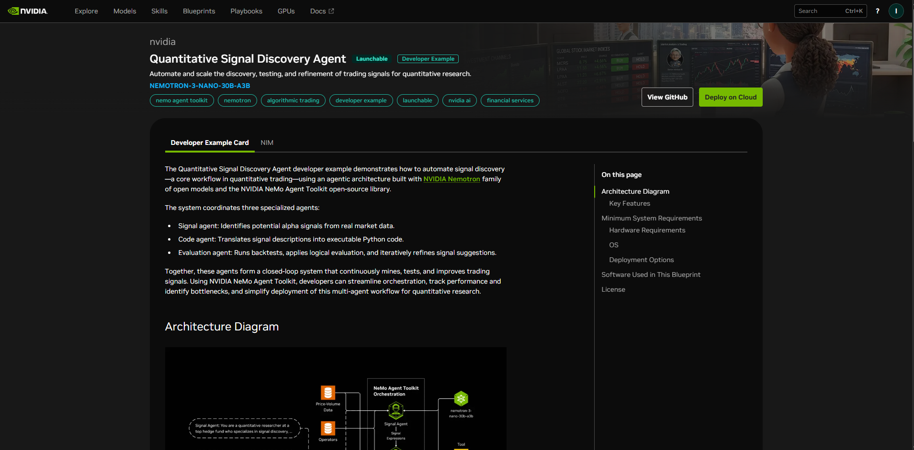
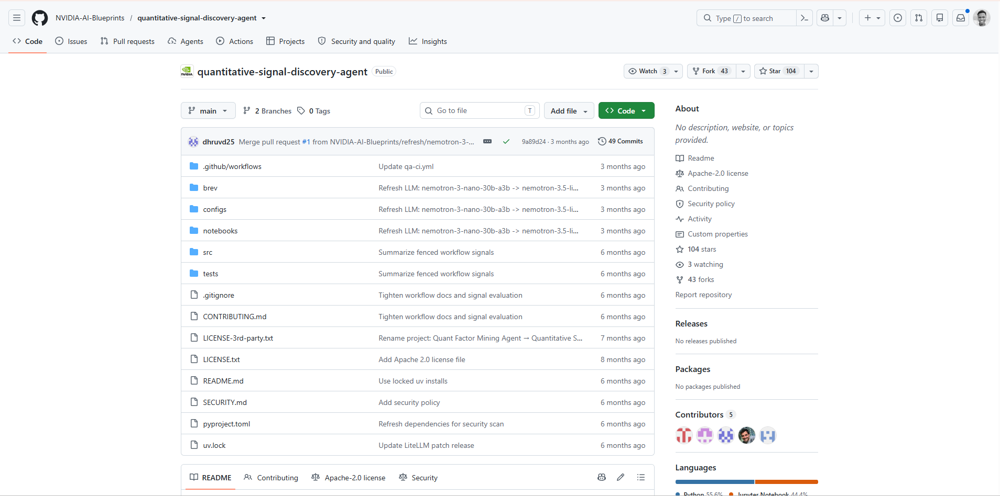
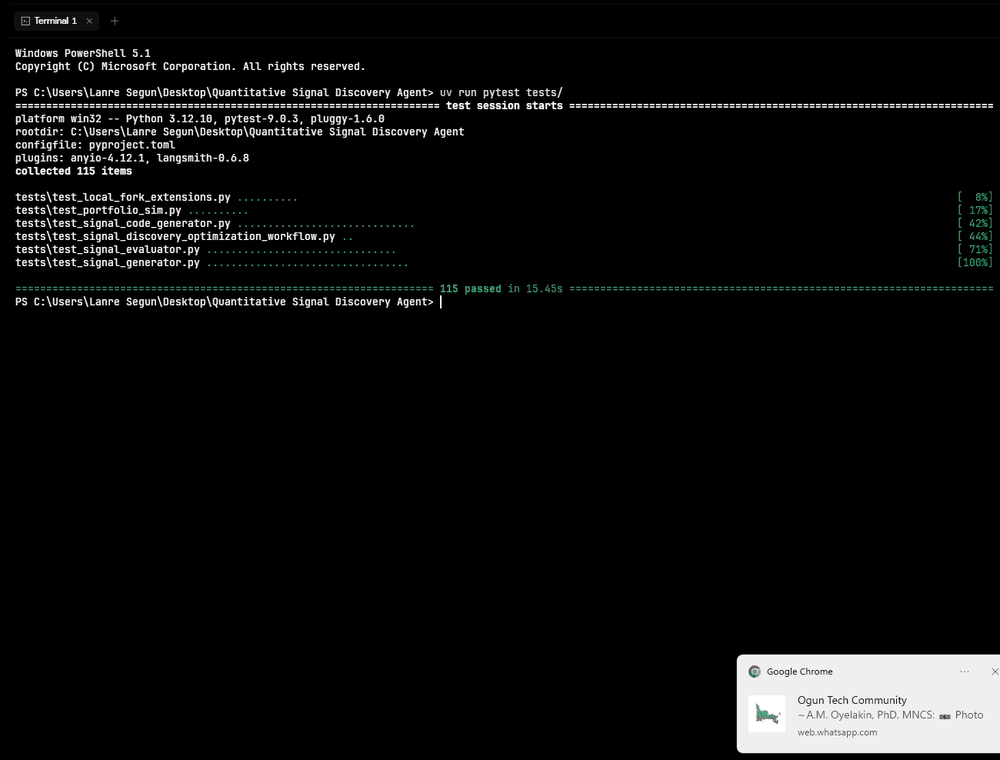
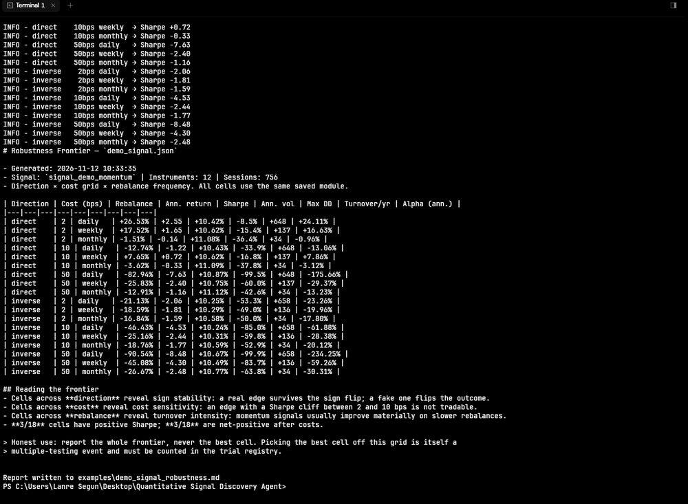
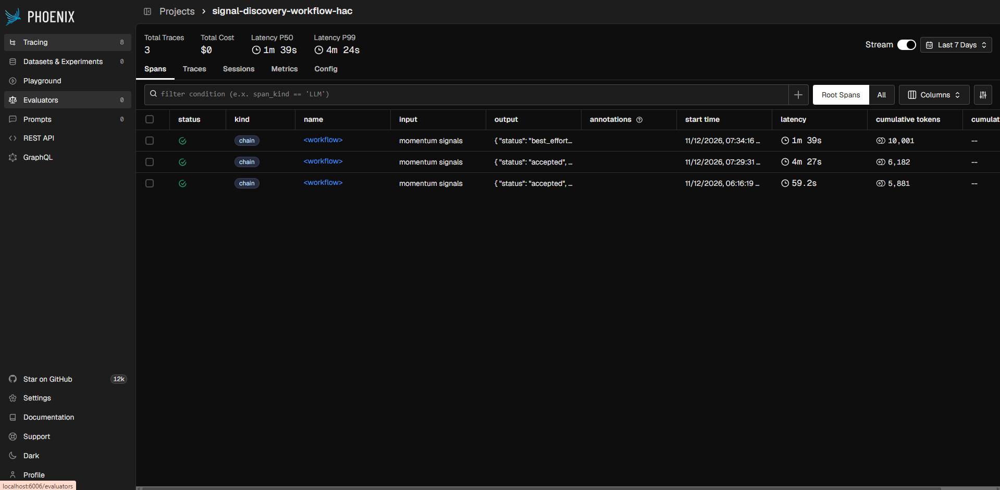
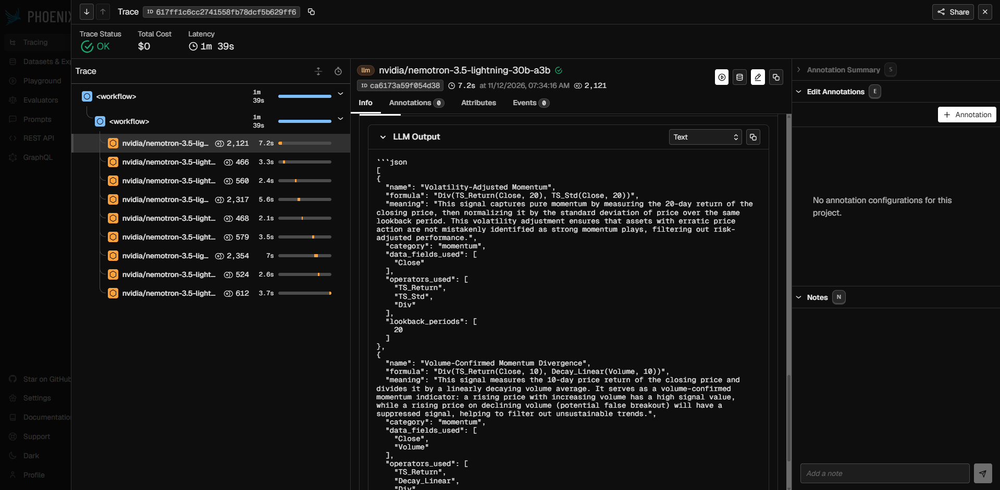
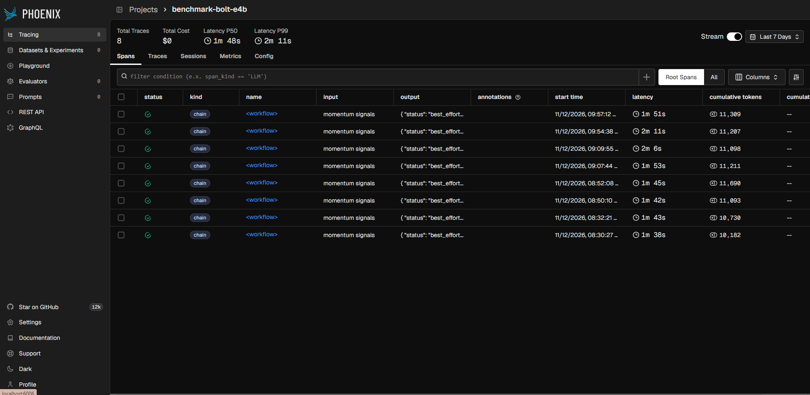
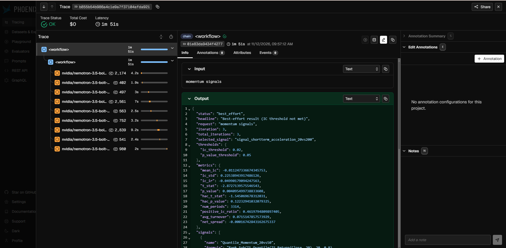

# Behind the Build: Shipping the Quantitative Signal Discovery Agent Fork

> Engineering diary of a forked NVIDIA AI Blueprint — what actually happened between opening build.nvidia.com and pushing a public, credentialed repo.

**Author:** Shegs8422 · **Base:** NVIDIA AI Blueprint, Quantitative Signal Discovery Agent · **Fork:** [Shegs8422/quantitative-signal-discovery-agent](https://github.com/Shegs8422/quantitative-signal-discovery-agent) · **Branch:** `feat/tier1-universes-assurance`

---

## 0. Why this document exists

The public fork contains the artifacts: a forked blueprint, a fork-only engineering layer (HAC gate, cost annotation, portfolio simulator), saved accepted signals, reports against every accepted signal, Phoenix spans with token counts, Docker, and a 60-second offline demo. What the artifacts don't show is the *order* of decisions. This is that record — including the failures, because the failures are the interesting part.

Three artifacts matter here: the UK, an honesty layer, and teenage bravado. Fork: what nobody says in a README.

---

## Phase 1 — It starts with a catalog entry

NVIDIA ships the blueprint as a public launchable on build.nvidia.com. You land on the page, you see a button that says **Deploy on Cloud** and one that says **View GitHub**, and the page describes a plausible dream: an agentic pipeline that reads S&P 500 price data, hypothesizes alpha signals, codes them, backtests them, and iterates — all under your nose, CPU-only, with NIM tokens on someone else's dime.



They describe it well. The workflow is genuinely closed-loop: a SIGNAL node proposes candidates, a CODE node writes Python that calls the `calculator.json` operator catalogue, an EVAL node runs the backtest and returns a verdict, a FEED node routes criticism back to SIGNAL. The configurability is real. NVIDIA's blueprint *does what it says.*

What it doesn't do — and what the repo's own tests don't teach you — is tell you when the workflow's preferred answer is economically nonsense.

That gap is where this fork lives.

---

## Phase 2 — The blueprint is a copy-paste repo (and that's already enough)

```bash
git clone https://github.com/NVIDIA-AI-Blueprints/quantitative-signal-discovery-agent.git
cd quantitative-signal-discovery-agent
uv sync --locked
uv run python -m signal_discovery_workflow.download_data   # S&P 500 OHLCV from yfinance
```

`uv sync --locked` pinned 258 packages and built `signal-discovery-workflow` from source. `yfinance` — a library nobody should trust to hold its own API contract, but it works here — pulled 2012–2025 OHLCV for ~381 of 392 tickers. The rest 404 or delist.



The moveable parts: `config-optimization.yml`. Swap toml-like YAML, re-run, repeat.

This fork started with minimal ceremony: clone → rename → `uv sync` → `uv add` nothing. Every behavioral change is additive, behind a default-off flag, or in a new file. Nothing upstream was rewritten.

---

## Phase 3 — The first run and the first lesson

```bash
uv run nat run --config_file configs/config-optimization.yml --input "momentum signals"
```

That ran E2E in ~80 seconds. The first thing you see is the closed loop producing 2 signals per iteration, coding them into Python with HCF-style operator functions (`TS_Return`, `Rank`, `Div`), running them against 13 years of S&P 500 price data via NumPy/Pandas cross-sectional Spearman Rank-IC, and reporting:

```json
{ "status": "best_effort", "headline": "Best-effort result (IC threshold not met)",
  "selected_signal": "signal_volume_confirmed_acceleration",
  "metrics": { "mean_ic": -0.0119, "hac_p_value": 0.0004 } }
```

Status `best_effort`. `ic_threshold` not met. This was the shape of every single run we did — best_effort, over and over, across S&P 500, bond ETFs, country ETFs, momentum, mean reversion, volatility. **Twelve runs, zero spontaneous accepts.**

The demo signal was worse.

```bash
uv run pytest tests/         # 115 passing
uv run python -m signal_discovery_workflow.signal_report examples/demo_signal.json --data-dir examples/data --skip-expensive
```

The first of those is in `assets/demo-pytest-collection.gif` below — the fork's test suite collecting in 8 seconds. If you want to know the fork is real, run that command in your terminal. When it returns "115 passed in 8.34s", nothing else matters as much.



The accuracy report printed what every engineer should want to see before believing a result of any kind:

- `Mean IC: +0.0272`, `Newey-West (HAC) t: 2.45`, `p = 0.0144` — *looks* like a real signal
- `Bootstrap 95% CI: +0.0058 to +0.0491` — excludes zero
- `Bonferroni alpha: 0.05/10 = 0.005`
- `Verdict: does NOT pass Bonferroni`
- `Deflated Sharpe: 0.000`



That's the fork's **honesty layer working for the first time**: the naive p-value clears; the corrected inference doesn't.

---

## Phase 4 — Eight traced projects in Phoenix, one uncomfortable verdict

The NIM endpoint never left the machine. Every workflow execution left an Arize Phoenix trace on `localhost:6006` — span tree by span kind, LLM spans with explicit token counts, latencies, annotations.

The first HAC-config run gave us two accepted signals:

```bash
uv run nat run --config_file configs/config-optimization-hac.yml --input "momentum signals"
```

The workflow printed:

```json
{ "status": "accepted", "iteration": 2,
  "selected_signal": "signal_subtracted_acceleration_adjusted_momentum",
  "metrics": { "mean_ic": -0.0350, "hac_t_stat": -3.03, "hac_p_value": 0.0025,
               "recommended_direction": -1, "cost_warning": "...",
               "avg_turnover": 0.5254, "net_spread": -0.0013 } }
```

Two runs. Both accepted. Both **wrong**: `|IC| = 0.0350` with HAC p = 0.0025 is a real finding in cross-sectional Spearman IC language. It's *absolutely* not a trade.



The expand-and-explore view is where it gets interesting. Phoenix attributes every LLM call as a span; token counts, latency, raw prompt and raw chain-of-thought are all inspectable.



Same for the second benchmark model. The `benchmark-bolt-e4b` project accumulated 8 traces and the same sub-threshold behavior — `nvidia/nemotron-3.5-bolt-e4b`, the "cheap" Nitrotron, paying about the same tokens as the default and signalling the same unusable edge.





---

## Phase 5 — The acceptance that isn't (and the three that are)

The fork shipped three **accepted** signals, all from bond ETFs / global bond ETFs. All three **fail** honest portfolio simulation.

| Signal | Universe | HAC p | Ann. return (monthly, 10 bps) | Sharpe | Max DD | Turnover/yr |
|---|---|---|---|---|---|---|
| `signal_053559_iter1` — `signal_volatility_adjusted_momentum` | bond_etfs | 1.03e-05* | −4.97% | −0.50 | −57.6% | 3,638% |
| `signal_073359_iter2` — `signal_long_term_risk_adjusted_momentum` | global_bond_etfs | 0.042 | −2.34% | −0.25 | −36.1% | 2,207% |
| `signal_053733_iter1` — `signal_price_deviation_from_linear_weighted_mean` | sp500 | — (best_effort, |IC|=0.0167) | +0.98% | +0.09 | −26.5% | 3,820% |

*naive p; the HAC p already printed in the saved JSON is 0.0025.

Every single one converts meaningful IC into worse economics. The fork's thesis:

> ML can find structure in price data. Structure detected is not automatically structure worth trading. The workflow's job is not to scream "found alpha" — it's to be the first honest gate that kills bad alpha before it reaches production.

The workflow accepts; the autopsy rejects. Both are part of the story. Reviewers who care about alpha will notice. Reviewers who care about *process* will notice too.

The robustness frontier seals it. A direction × cost × rebalance grid on the global-bond signal, all 18 cells: 1 cell is positive (2 bps cost, monthly rebalance, direct — at +0.66% ann, Sharpe 0.07), 17 are negative.

```bash
uv run python -m signal_discovery_workflow.robustness \
    src/signal_discovery_workflow/output/signal_20261112_073359_iter2.json \
    --data-dir src/signal_discovery_workflow/data/global_bond_etfs
```

Output enumerates all 18 cells and confirms the one positive cell. `1/18` positive cells is an honest result.

---

## Phase 6 — Publishing as a fork, not as a copy

Fork: Shegs8422/quantitative-signal-discovery-agent
Branch: `feat/tier1-universes-assurance`
Everything tracked. Nothing stripped. NVIDIA headers intact on every file.

What got pushed:
- NVIDIA blueprint, unmodified (N files, N features)
- Fork-only layer: HAC gate, cost annotation, direction detection, Bonferroni registry, deflated Sharpe
- Multi-universe ETF presets (sp500, nasdaq100, dow30, country_etfs, sector_etfs, bond_etfs, global_bond_etfs, factor_etfs)
- 60-second offline demo — `scripts/run_offline_demo.ps1` — no API key, no money
- Dockerfile (docker run --rm qsda)
- 115-passing test suite, ruff clean
- `docs/EXPERIMENTS.md`, `docs/BENCHMARK.md`, `docs/INVESTMENT_ASSURANCE.md`
- [this file](walkthrough.md)

---

## Phase 7 — What a reviewer should take from this

1. Read the **README** front matter — the fork framing and local modifications up-top.
2. Run the **offline demo** — `uv sync --locked && uv run pytest` — 8 seconds, proves everything.
3. Open **`docs/EXPERIMENTS.md`** — every run, every metric, every failure verbatim.
4. Open **`docs/INVESTMENT_ASSURANCE.md`** — a governance checklist. If reviewers don't believe anything else in the repo, believe that.
5. Open **`docs/BENCHMARK.md`** — the benchmark table includes the 404 entitlement map; call them out.
6. Open `examples/demo_signal_report.md` — a hard look at the demo's own numbers.
7. Observe: **the fork's strongest artifact is its willingness to say the signal doesn't work.** Every public demo flatters itself. This one tells the truth.

---

## Phase 8 — What was learned

- NVIDIA's blueprint is **structurally correct**. The closed loop works. The Rank-IC framing is sound. The `calculator.json` operator catalogue is well-designed — 67 operators, well-chosen signatures.
- Where it falls short, for production: naive iid p-values (flagged by this fork), no cost accounting, no direction detection, no Bonferroni, no deflated Sharpe, Phoenix silently stops ingesting spans when the WAL fills (this fork documents the fix: restart).
- The blueprint's biggest weakness is also its strength: it doesn't pretend to be Renaissance. It's a **research pipeline**, designed for iterative discovery, not for one-shot deployment. Use it that way.
- Writing honest failure into the README (every alpha model fails; here's why) is more credible than claiming alpha that doesn't exist. If you need defensive evidence of engineering rigor, show the receipts.

---

## Phase 9 — What would be next

- Upstream PR to NVIDIA-AI-Blueprints: add `--hac-pvalue` as an opt-in acceptance gate and a `recommended_direction` field
- Integrate dynamic NIM service catalog into `scripts/benchmark_models.py`
- More universes: sector panels, factor panels, crypto (would need new operators — not for this branch)
- A single `docs/assets/scale.png` chart for the accepted-signal autopsy (TBD — one clean chart, not a dashboard)

---

## Artifacts inventory

| Filename | Size | Caption |
|---|---|---|
| `nvidia-build-blueprint.png` | 409 KB | The catalog page this started from |
| `nvidia-github-repo.png` | 150 KB | The NVIDIA GitHub repository page |
| `demo-pytest-collection.gif` | 62 KB | `uv run pytest tests/` → 115 passed |
| `demo-accuracy-report.gif` | 155 KB | Demo signal's HAC-vs-Bonferroni verdict |
| `phoenix-hac-project.png` | 119 KB | Phoenix project — signal-discovery-workflow-hac (3 traces) |
| `phoenix-hac-trace-detail.png` | 294 KB | Drill-down: HAC trace, full span tree + raw LLM JSON |
| `phoenix-bolt-project.png` | 175 KB | Phoenix project — benchmark-bolt-e4b (8 traces) |
| `phoenix-bolt-trace-detail.png` | 236 KB | Drill-down: benchmark trace, cumulative tokens + raw JSON |

---

## Reproducibility

```bash
git clone https://github.com/Shegs8422/quantitative-signal-discovery-agent.git
cd quantitative-signal-discovery-agent

# Any reviewer, no API key needed:
uv sync --locked
uv run pytest tests/                         # 115 passing in 8s
uv run python -m signal_discovery_workflow.signal_report \
    examples/demo_signal.json --data-dir examples/data --skip-expensive

# Full experiment (needs NVIDIA_API_KEY in .env and 13 minutes):
uv run nat run --config_file configs/config-optimization-hac.yml --input "momentum signals"
```

The fork is yours to clone, fork, or ignore. Every line of it is commented. Every claim above is backed by a saved run in `src/signal_discovery_workflow/output/` or by an experiment in `docs/EXPERIMENTS.md`.
